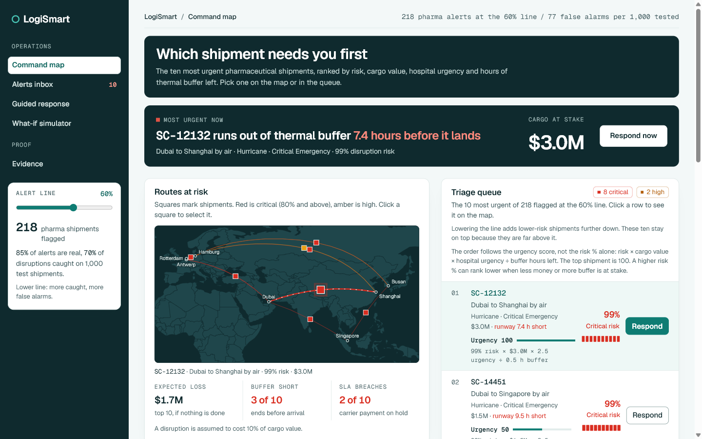

# LogiSmart: early warning for pharmaceutical shipments

**Dormathon 2026, Track 1: Predict Early, Decide Better** (organised by AI Hackerdorm)

**Team Aura:** Han Zun Ding, Chen Zhe Tein, Ryan Hew Ka Shing

**Live demo:** https://dormathon-2026-nine.vercel.app

LogiSmart warns a logistics coordinator that a pharmaceutical shipment is likely to be disrupted, and shows which action is worth paying for, while the shipment is still moving.



---

## The problem

A healthcare logistics coordinator watches dozens of pharmaceutical shipments at once. Today they learn that a batch was delayed or spoiled only after it arrives. By then the medicine is lost and the hospital is short.

## Who it is for

One user: the logistics coordinator who decides which shipment to act on, and what to do about it, while the shipment is still moving.

## What LogiSmart does

LogiSmart scores every active shipment and walks the coordinator through five steps.

| Step | Question | What LogiSmart shows |
|---|---|---|
| Detect | Will it be disrupted? | A disruption risk from 0 to 100%, in four tiers (Low, Medium, High, Critical) |
| Categorize | What kind of trouble? | Transport delay, cold-chain excursion, or a delay leading to an excursion |
| Prioritize | Which shipment first? | A queue ranked by risk, cargo value, hospital urgency and thermal buffer left |
| Explain | Why? | The top 3 reasons in plain words, for example "Hurricane on the route. In clear weather the risk would be 46% instead of 99%." |
| Decide | What should we do? | Each action with its fee, the risk before and after, the net saving and the thermal runway gained |

It also includes a simulated Smart SLA (a breach notice and escrow lock when risk is above 80% and the buffer is under 3 hours) and a digital custody handshake that releases the escrow once a corrective action is logged.

## Does the model work?

Measured on 1,000 shipments the model never saw during training.

| Measure | Result |
|---|---|
| Precision (alerts that are real) | 85% |
| Recall (disruptions caught) | 70% |
| F1 score | 0.77 |
| ROC AUC | 0.83 |
| False alarms per 1,000 shipments | 77, against 387 if every shipment is flagged |

The model also holds up when its inputs are imperfect: scores barely move with 30% noise on the numbers, a backup model takes over when the weather is missing, and bad input returns "Insufficient data for reliable prediction" and never crashes. The full evidence is in `notebooks/05_final_model_and_evaluation.ipynb`.

## What is real and what is assumed

- **The shipments are simulated.** The dataset is general cargo (5,000 shipments, 1,006 of them pharmaceuticals) and looks generated. The scores show that the method works, not how it would score on a real carrier's records.
- **LogiSmart covers air and road shipments.** Sea and rail are out of scope. The model still learns from all four modes, because mode does not change how often a shipment is disrupted. On air and road test shipments alone it scores precision 86% and recall 74%.
- **The model predicts disruption, not spoilage.** The data records only whether a shipment was disrupted. Thermal runway (buffer hours left against hours still to go) shows whether the cargo would survive that disruption.
- **Cargo value, storage standard, thermal buffer and hospital urgency are simulated** by `src/build_dataset.py`. They are used for ranking and money, never as model inputs.
- **Action fees, action effects and the cost of a disruption (10% of cargo value) are assumptions.** A real team would replace them with its own figures.
- **Weather** for a newly entered order can be filled in live from Open-Meteo (the worse of the current weather at the two ends of the route). If the service cannot be reached, a backup model scores the order without weather.
- **Route risk** for a newly entered order comes from the World Bank political stability index (2025), converted to a 0 to 10 score. It is a yearly figure. A live source such as ACLED can be plugged in later.

## Run it

```
python -m venv .venv
.\.venv\Scripts\Activate.ps1
pip install -r requirements.txt
cd web
npm install
npm run build
cd ..
python server.py
```

The app opens at http://localhost:8000. `server.py` serves both the React app (built into `web/dist`) and the JSON API over the Python model. Run the tests with `python -m pytest`.

An earlier Streamlit version of the same screens is kept as a fallback: `streamlit run app.py`.

## Use the backend directly

```python
from src.intake import assess_order

result = assess_order({
    "Place_of_Origin": "Frankfurt CargoCity",
    "Place_of_Destination": "Kuala Lumpur General Hospital",
    "Transport_Mode": "Air",
    "Lead-Time in days": 3,
    "Transit_Duration": 60,          # hours elapsed
    "Buffer_of_Package": 2.8,        # thermal hold hours left
    "Cargo_Value_USD": 85000,
    "Hospital_Urgency_Tier": "Critical Emergency",
    "Weather": "Storm",              # optional
})
```

`result` holds `risk`, `failure_mode`, `priority`, `explanation`, `thermal`, `actions`, `sla` and `scorecard`. Pass `live_weather=True` to fill in a missing weather field from Open-Meteo.

## Repository

```text
server.py              Web server: JSON API over the model, plus the built React app
web/                   React app (Vite, TypeScript): the five screens
app.py                 Streamlit fallback of the same screens (aura_app.py, deck/)
src/
  intake.py            One order in, one full assessment out
  model.py             Loads the saved model and scores shipments
  features.py          Builds the model's features
  explain.py           Plain-language reasons for a risk score
  prioritize.py        Triage queue
  recommendations.py   Actions, fees, net savings and the Smart SLA
  protocols.py         Custody handshake and audit trail
  weather.py           Live weather from Open-Meteo
  build_dataset.py     Rebuilds the training file from the raw file
notebooks/             01 to 05: data checks, features, model choice, final evaluation
models/                aura_final_model.pkl, written by notebook 05
data/                  Raw file and the rebuilt training file
tests/                 77 tests covering the model, the order flow, the SLA and the weather lookup
```

## Technology

Python 3.13, pandas, NumPy and scikit-learn (logistic regression) behind a Starlette API; React 19 with Vite, Recharts, Sonner, NumberFlow, zustand and d3-geo for the interface. Streamlit and Plotly power the fallback app.

**How AI is used:** a machine-learning model (logistic regression, trained in notebook 05) predicts the disruption risk of each shipment from weather, route risk, carrier reliability, lead time, distance and transport mode. The same model re-scores the shipment for every action, which is how the app shows the risk before and after. The app was built with Claude Code as a coding assistant.
